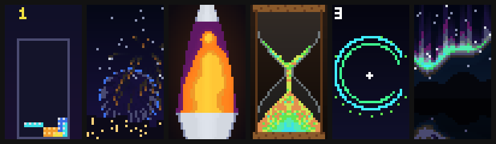
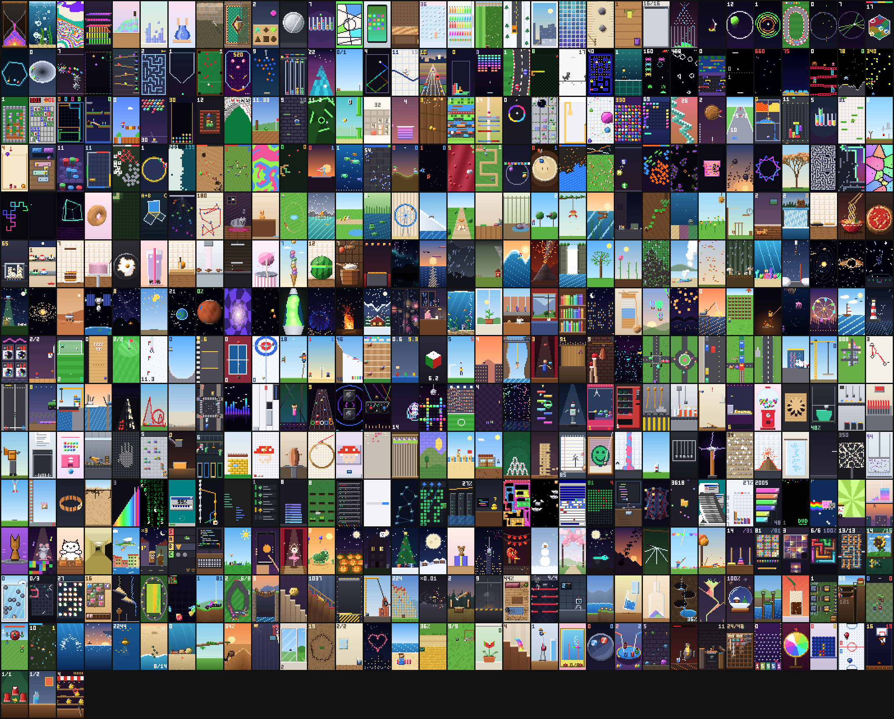

# brainrot-break

[](https://github.com/BordyV/brainrot-break/releases/latest)
[](https://github.com/BordyV/brainrot-break/actions/workflows/check.yml)
[](https://code.claude.com/docs/en/plugins/mods/overview)
[](#notes)
[](#commands)
[](LICENSE)

**A feed of pixel art mini-videos to scroll while Claude thinks.**

When an answer from Claude takes more than a couple of seconds, a TikTok-style feed opens next to it: scroll, like, and the feed tells you when Claude is done. It plays in the Claude Code terminal and in the Claude desktop app, in English, French, Spanish, German, Portuguese or Italian. Everything is drawn locally: it uses no tokens and calls no model.



**[Try the feed in your browser](https://bordyv.github.io/brainrot-break/)**: every video, playing as in the mod.

## Install

At the prompt of a Claude Code session:

```
/plugin marketplace add BordyV/brainrot-break
/plugin install brainrot-break@brainrot-break
```

From a shell:

```
claude plugin marketplace add BordyV/brainrot-break
claude plugin install brainrot-break@brainrot-break
```

In the Claude desktop app, where `/plugin` doesn't run: click **+** next to the prompt box, then **Plugins**, **Add marketplace** with `BordyV/brainrot-break`, then **Add plugin**.

To update later: `claude plugin update brainrot-break@brainrot-break`, then `/reload-plugins` or a new session.

## How it works

- Ask Claude something. If the answer takes more than ~2.5 s, the **For you** feed opens.
- When Claude has answered, the video dims and a card says **✓ Claude has answered**, with what you watched while waiting. Keep scrolling or close it; it closes by itself after 15 s.
- A video can belong to several themes (Jenga is crafts and destruction). It shows as soon as one of its themes is ticked: *Hide all* then ticking robots brings every robot video.
- Kinds you like come back sooner, and kinds you skip in the first 2 s a little later (scroll back within 10 s and that skip is forgotten). Scroll back and a video picks up where you left it.

## Controls

| Action | Mouse | Keys* |
| --- | --- | --- |
| Next / previous video | wheel, ▼ / ▲ | `j` / `k` |
| Pause | click the video | space |
| Like | double-click the video, ♥ | `l` |
| Comments | ≡ | `m` |
| Not interested (fewer videos like this one, Undo for 5 s) | ⊘ | `n`, then `u` to undo |
| Only this video's theme for now (click again or ✕ to stop) | the #hashtags at the end of the caption | |
| Menu: themes, my likes, settings | ··· at the top of the side column | `t` |
| Shortcuts | ? under ··· | `h`, or `?` once the video has been clicked |
| Keep scrolling / close the end card | buttons | `c` / `x` |

\* Keys work once the feed holds the keyboard: `ctrl+x tab` gives it to the feed, `Esc` gives it back to the prompt. Once the video has been clicked, it takes the keys too.

## Choose what you see

- **⊘ Not interested** (`n`): fewer videos like this one, and a little fewer of its theme. It never hides anything: a kind you mark comes back every few rounds instead of every round. `⊘ Fewer "…" · Undo` shows for 5 s under the caption (`u`).
- **··· menu** (`t`), at the top of the side column, on the playing video:
  - *Not interested*, as ⊘;
  - *Hide #theme*: unticks this video's theme, so its videos stop coming unless another of their themes is ticked;
  - *Choose my themes…*: every theme with its number of videos, to switch on or off (one always stays on), *Show all* and *Hide all* (all but the playing video's, then switch on the ones you want);
  - *My likes*: the videos you liked, kept between sessions, to watch again;
  - *Settings…*: language, opening while Claude works, next video by itself;
  - *Forget my "not interested"*: back to an even feed, likes kept.

## Commands

| Command | What it does |
| --- | --- |
| `/brainrot` | Open the feed now |
| `/brainrot stats` | Videos watched, likes, time and your favorite kinds, this session and all time |
| `/brainrot off` / `on` | Turn the automatic feed off or on |
| `/brainrot lang en\|fr\|es\|de\|pt\|it` | Switch the feed's language (also in ··· › Settings) |
| `/brainrot fps 0-15` | Desktop app only: how many times a second the video redraws (`0` freezes it) |

The language can also be set in the plugin's config (`language`: `en`, `fr`, `es`, `de`, `pt` or `it`). English is the default.

## The videos

454 of them, in 33 themes:



- **Satisfying & ASMR** (24): hourglass, bubbles, paint mixing, dominoes, kinetic sand, soap cubes, slime stretch, pressure washing, carpet cleaning, perfect fit, laser rust removal, ball sort, paint bucket, screen film peel, wood planer, bubble wrap, fridge restock, lawn stripes, snow plough, window squeegee, floor tiling, zen garden, folding laundry, dishwasher Tetris.
- **Ball & marble physics** (25): marbles, double pendulum, growing ball, escape the rings, marble race, ball splits, string art bounce, which colour wins, spinning hexagon, marble funnel, balls vs saws, bounce flashes, marble machine, gravity maze, 100 balls one hole, snooker, pinball, peg breaker, colour gates, sky track, will it make it, rainbow ball, sled on a drawn line, Plinko*, pendulum wave*.
- **Retro arcade** (33): runner, Tetris, brick breaker, racing, Snake, Chrome dino, Pac-Man, Geometry Dash, space invaders, asteroids, frog crossing, pong, galaxy dive, missile defence, barrel climber, lunar lander, centipede, bomber maze, minesweeper, light cycles, lemmings, platformer, bubble shooter, falling jewels, sokoban, solitaire win, speedrun, rage climb, closing hexagon, horde survivor*, air hockey*, arcade hoops*, shooting gallery*.
- **Mobile games** (30): flappy bird, 2048, stack tower, fruit slicing, road crossing, helix jump, colour switch, hole in the city, territory, cell eater, match-3, block blast, zigzag, knife throw, crowd runner, pull the pin, parking jam, water sort, doodle jump, slingshot birds, merge watermelon, screw jam, hexa sort, colour block jam, runner*, sky track*, flow connect*, unblock the arrows*, triple tile match*, merge army*.
- **Versus & battles** (21): rock paper scissors, flag battle royale, pong wars, ant colony war, red vs blue armies, colour spirals, snake vs snake, stick duel, big fish, zombie outbreak, tank duel, space dogfight, immune system, tower defence, colour tournament, sumo bots, fire vs water, foxes and rabbits, last ball standing, fire water grass, battling tops*.
- **Generative art & maths** (16): Game of Life, Langton’s ant, boids, spirograph, fractal tree, maze solver, A* pathfinding, Voronoi growth, dragon curve, Hilbert curve, spinning cube, spinning donut, wave function collapse, water Pythagoras, pendulum wave, travelling salesman.
- **Animals & pets** (27): sleeping cat, cat vs glass, dog zoomies, capybara spa, ducklings, frog and flies, hamster wheel, penguin slide, corgi walk, cat vs cucumber, baby hippo, frisbee dog, bird feeder, otters, raccoon raid, leafcutter ants, octopus camouflage, bees, squirrel course, cat vs laser pointer, salmon run, cat on the keyboard*, whale breach*, turtle hatchlings*, shell swap*, sheepdog*, seagull heist*.
- **Food & cooking** (17): pancake flip, ramen pull, pizza toppings, popcorn, sushi conveyor, burger stack, cake frosting, frying an egg, bubble tea, fruit slices, donut glazing, smash burger, cotton candy, ice cream tower, watermelon bands, mochi pounding, tanghulu.
- **Nature & weather** (16): northern lights, sunset at sea, thunderstorm, tornado, surfer, volcano, waterfall, four seasons tree, flower bloom, forest fire, geyser, falling leaves, mushrooms after rain, coral reef, caterpillar to butterfly*, salmon run*.
- **Space & sci-fi** (14): rocket landing, solar system, black hole, warp speed, UFO abduction, planet formation, Mars rover, space docking, meteor shower, test flight, Kessler cascade, terraforming, wormhole, three-body problem.
- **Cozy & lo-fi** (24): lava lamp, fireworks, campfire, snowy cabin, rainy window, lo-fi study desk, aquarium, windowsill plant, café window, train window, bookshelf tidy, night city windows, knitting, hot air balloons, lantern festival, fishing dock, farm crops, toasting marshmallows, jellyfish, ferris wheel, sailing, lighthouse, laundromat at night, snow globe*.
- **Sports** (28): trick shots, penalty shootout, bowling strike, hole in one, ski slalom, skate halfpipe, pit stop, table tennis, curling, archery, beach volleyball, ski jump, horse race, cup stacking, speed cube, keepy-uppy, parkour, bungee jump, juggling, wall of death, speed bag, drag race*, monster truck*, snooker*, pinball*, stadium wave*, surfer*, arcade hoops*.
- **Vehicles & city** (18): cyberpunk city, traffic lights, roundabout, parallel parking, level crossing, runway, car wash, tower crane, city builder, metro map, drag race, monster truck, container port, drawbridge, night highway, rollercoaster, building demolition, scramble crossing.
- **Music & dance** (13): audio visualiser, piano tiles, trend dance, guitar highway, bass drop, DJ decks, rhythm circles, disco floor, stadium wave, conga line, dancing fountain, marble xylophone, dancing robot.
- **Machines & how it's made** (22): claw machine, vending machine, assembly line, bottling line, Rube Goldberg machine, coin pusher, gumball machine, laser cutter, 3D printer, colour sorter, crayon factory, wood chipper, paper shredder, gacha machine, robot arm, pin art, warehouse robots, metal casting, recycling plant, factory automation*, combine harvester*, canal lock*.
- **Crafts & makers** (14): brick build, pixel art drawing, pottery wheel, cross-stitch, fuse beads, mosaic, weaving loom, mural, sandcastle, block house, card tower, Jenga collapse, flip-book, rug tufting.
- **Science experiments** (17): elephant toothpaste, Mentos and cola, Newton’s cradle, Tesla coil, mousetrap chain reaction, baking soda volcano, crystal growth, water balloon slow-mo, Chladni plate, gas in a box, water rocket, egg drop, coil train, ant farm, pendulum wave*, water Pythagoras*, drinking bird*.
- **Developer humour** (26): sorting, Matrix rain, stuck at 99%, git branches, merge conflict, CI pipeline, stack overflow, whack-a-bug, server rack, loading spinners, network packets, garbage collector, memory leak, rubber duck debugging, pipes screensaver, flying toasters, disk defragmenter, test suite, robot coder, neural network, node_modules, error cascade, calendar Tetris, bar chart race, cat on the keyboard*, touch grass*.
- **Internet memes** (17): DVD logo, Nyan Cat, absurd creature parade, split-screen runner, spinning cat, rat dance, bongo cat, the backrooms, tier list, cat on the keyboard, touch grass, the feed in the feed, and four Italian brainrot heroes: Coccodrillo Bombardiere, Tronchetto Tum Tum, Ballerina Cappuccina and Elefantino Cactusino; and speedrun*.
- **Seasons, holidays & spooky** (15): pumpkin patch, haunted house, Christmas lights, sleigh across the moon, unwrapping, New Year’s ball drop, dragon dance, snowman, cherry blossoms, witch’s cauldron, bats at dusk, spider web, piñata, leaf pile, snow globe*.
- **Puzzles & logic** (18): Tower of Hanoi, sudoku solver, sliding 15-puzzle, flow connect, pipe rotation puzzle, jigsaw, ice sliding puzzle, laser mirrors, unblock the arrows, triple tile match, sokoban*, minesweeper*, 2048*, water sort*, ball sort*, screw jam*, hexa sort*, colour block jam*.
- **Simulations & emergence** (13): falling sand world, phantom traffic jam, particle life, genetic cars, cars learn to drive, rope bridge, soft bodies, ragdoll stairs, Game of Life*, Langton’s ant*, boids*, foxes and rabbits*, zombie outbreak*.
- **Destruction** (11): hydraulic press, wrecking ball, voxel tower collapse, slow-motion bullet, wood splitting, barrel chain, building demolition*, Jenga collapse*, card tower*, wood chipper*, dam break*.
- **Sci-fi, robots & mecha** (9): robot vacuum, laser grid heist, robot learns to walk, robot arm*, warehouse robots*, robot coder*, sumo bots*, dancing robot*, drone light show*.
- **Fluids, sand & particles** (13): dam break, tilting glass, sand art bottle, water filling a cave, sand funnel maze, snow globe, canal lock, fizzy pour, hourglass*, kinetic sand*, falling sand world*, lava lamp*, elephant toothpaste*.
- **Idle, strategy & tycoon games** (7): factory automation, idle mine, auto battler, merge army, horde survivor, city builder*, tower defence*.
- **Ocean & underwater** (11): bait ball, whale breach, deep-sea dive, turtle hatchlings, shell swap, surfer*, jellyfish*, coral reef*, octopus camouflage*, aquarium*, sailing*.
- **Insects & tiny worlds** (10): caterpillar to butterfly, dung beetle, mosquito vs swatter, fly at the window, ant mill, bees*, leafcutter ants*, ant farm*, ant colony war*, spider web*.
- **Birds, sky & flight** (7): paper plane, drone light show, seagull heist, hot air balloons*, bird feeder*, bats at dusk*, lantern festival*.
- **Farm, garden & plants** (5): combine harvester, sheepdog, Venus flytrap, farm crops*, pumpkin patch*.
- **Toys & desk toys** (7): slinky on the stairs, drinking bird, water ring toss, battling tops, fishing game, Newton’s cradle*, coil train*.
- **Fantasy & RPG** (5): slime merge, boss fight, forging a sword, inventory packing, witch’s cauldron*.
- **Party, board & fair games** (13): Plinko, wheel of prizes, four in a row, air hockey, arcade hoops, cup shuffle, bottle flip, shooting gallery, claw machine*, coin pusher*, gumball machine*, gacha machine*, piñata*.

\* Also in this theme, though its home is another one: a video can have several themes.

Each one is a small simulation of a few hundred lines, drawn at 32 × 56 pixels and about 15 frames a second. They live in [`plugin/hooks/themes/`](plugin/hooks/themes), one file per theme.

## Notes

- Terminal and desktop app: the terminal draws the video with half-block characters at ~15 frames a second, the desktop app as an SVG at up to 10. VS Code and mobile show a note instead.
- In the terminal, the feed opens as a pane beside the conversation from 144 columns (110 once you have opened it with `/brainrot`); on a narrower terminal a line by the prompt says so, with a button to move the feed to the side from 110 columns. Below 110 columns there is no room beside the conversation: widen the window and the feed comes back where it was.
- In the terminal, clicks need Claude Code's fullscreen layout; the wheel and keys work everywhere.

## Development

```
npx tsx tools/check.ts                 # type-check, validate, tests, offline render
npx tsx tools/render.ts [kind|theme]   # look at the videos without a session
npx tsx tools/gif.ts                   # rewrite assets/feed.gif
npx tsx tools/social.ts                # rewrite assets/social.png, the link preview
npx tsx tools/new-video.ts <theme> <kind> "<English name>" "<French name>"
```

`claude --plugin-dir plugin` starts a session with the mod loaded from its folder, `plugin/`. [AGENTS.md](AGENTS.md) explains how the mod works and how to add a video.

## License

[MIT](LICENSE). What changed in each version: [CHANGELOG.md](CHANGELOG.md).
